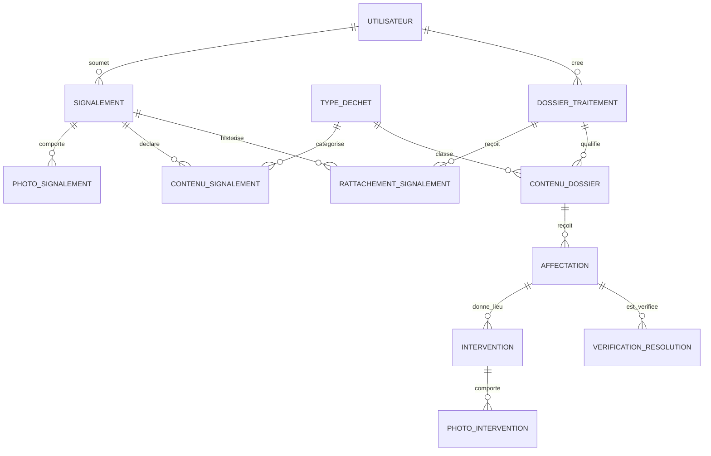
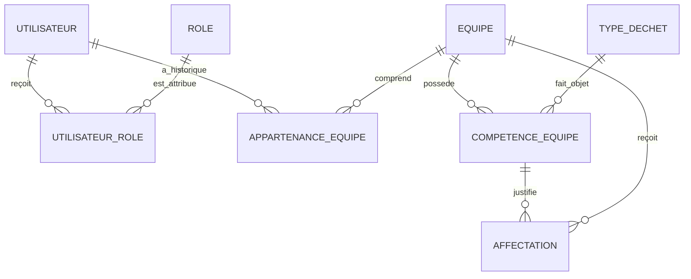
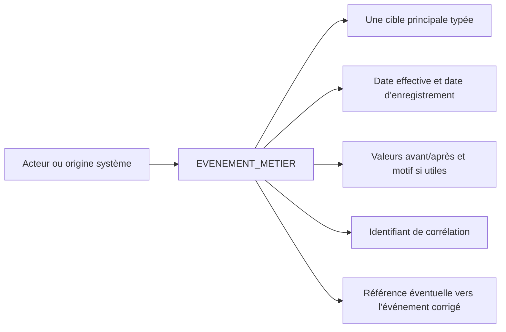

# Diagrammes conceptuels

Ces diagrammes représentent les associations principales et leurs cardinalités dans le scénario académique. Ils sont complémentaires au texte détaillé de `mcd.md`. Le modèle logique avec les clés est décrit dans `mld.md`.

## 1. Observation, dossier et traitement

**Lecture :** une même observation peut avoir plusieurs rattachements successifs dans l'historique, mais un seul rattachement actif à la fois. Un dossier contient des catégories qualifiées. Chaque ligne `AFFECTATION` porte sur une seule ligne dossier/catégorie encore à traiter ; une catégorie retirée est conservée pour l’historique et n’accepte plus d’affectation courante. Plusieurs affectations historiques sont possibles pour une même catégorie, mais une seule est courante.

## 2. Rôles, équipes et compétences spécialisées

**Lecture :** la relation `COMPETENCE_EQUIPE` est historisée. Une affectation référence la compétence exacte utilisée ; la validité de cette compétence à la date de l'affectation doit être vérifiée.

## 3. Journal de traçabilité

La cible principale est l'un des objets référencés par les colonnes typées de `EVENEMENT_METIER`. Exactement une cible doit être renseignée, la cible catégorie-dossier étant représentée par une paire de clés étrangères composée. Une correction crée une nouvelle trace ; elle ne réécrit pas l'événement original.

## 4. Règles qui ne se lisent pas uniquement sur le diagramme

- Un signalement n'est pas une intervention ; le lien entre le signalement et le dossier est historisé.
- Une affectation porte sur une seule catégorie et conserve la compétence d'équipe retenue.
- Une même catégorie d'un dossier ne peut avoir qu'une affectation courante à un instant donné.
- L'état `TERMINEE` d'une affectation suppose une vérification positive de sa catégorie.
- La clôture résolue du dossier dépend de toutes les catégories à traiter, non de la seule fin d'une intervention.
- Les contraintes de période, l'unicité conditionnelle des affectations courantes, la cible unique d'un événement et les contrôles de cohérence multi-tables sont précisées dans `mld.md`.
