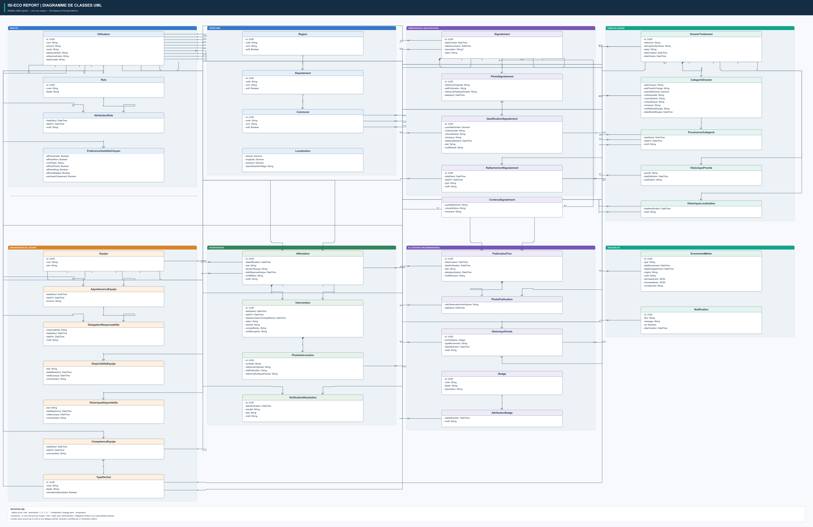

# Diagramme de classes métier cible

Ce diagramme présente le modèle métier proposé à valider avant l'alignement du
backend. Il couvre le signalement, la qualification, le dossier, les équipes,
les interventions, les vérifications et les publications citoyennes.

## Diagramme de classes UML unique

Le diagramme ci-dessous rassemble le modèle métier en une seule vue. Chaque
classe présente ses attributs privés (`-`). Les associations UML, leurs
multiplicités et les compositions remplacent les colonnes de clés étrangères :
une association exprime le lien métier, sans imposer la manière dont la base
de données le stockera.

Il s'agit d'un diagramme de classes métier statique : les opérations ne sont
pas détaillées, car cette vue décrit les concepts et leurs relations, pas les
méthodes d'implémentation.

Le SVG est à privilégier dans Word pour conserver la netteté au zoom. Pour une
impression lisible, utiliser une page paysage grand format (A1 ou A0) ou
conserver le document en SVG et zoomer à l'écran.

[SVG vectoriel](./diagramme-classes-metier.svg)

Les identifiants éventuels sont des attributs métier ordinaires dans cette
vue; la notation `PK`/`FK` relève du modèle relationnel et est volontairement
absente. Cette proposition reste à valider par le porteur métier.

## Source Mermaid détaillée

```mermaid
classDiagram
direction LR

namespace Identite {
  class Utilisateur {
    -UUID id
    -String nom
    -String prenom
    -String email
    -String passwordHash
    -String referenceAvatar
    -String etatCompte
  }
  class Role {
    -UUID id
    -String code
    -String libelle
  }
  class AttributionRole {
    -DateTime dateDebut
    -DateTime dateFin
    -String motif
  }
  class PreferenceVisibiliteCitoyen {
    -Boolean afficherAvatar
    -Boolean afficherNom
    -String nomPublic
    -Boolean afficherPoints
    -Boolean afficherRang
    -Boolean afficherBadges
    -Boolean participerClassement
  }
}

namespace Territoire {
  class Region {
    -UUID id
    -String code
    -String nom
    -Boolean actif
  }
  class Departement {
    -UUID id
    -String code
    -String nom
    -Boolean actif
  }
  class Commune {
    -UUID id
    -String code
    -String nom
    -Boolean actif
  }
  class Localisation {
    -Decimal latitude
    -Decimal longitude
    -Decimal precision
    -String repereQuartierVillage
  }
}

namespace ObservationEtQualification {
  class Signalement {
    -UUID id
    -DateTime dateConstat
    -DateTime dateSoumission
    -String? description
    -String statut
  }
  class ContenuSignalement {
    -String quantiteEstimee
    -String volumeEstime
    -String remarque
  }
  class PhotoSignalement {
    -UUID id
    -String referenceOriginale
    -String etatPublication
    -String referencePubliqueFloutee
    -DateTime dateAjout
    -UUID? varianteSoumisePar
    -DateTime? dateSoumissionVariante
    -UUID? approuvePar
    -DateTime? dateApprobation
    -Boolean floutageConfirme
  }
  class QualificationSignalement {
    -UUID id
    -Decimal quantiteEstimee
    -String uniteQuantite
    -String volumeEstime
    -String remarque
    -DateTime dateQualification
    -String etat
    -String motifRetrait
  }
  class RattachementSignalement {
    -UUID id
    -DateTime dateDebut
    -DateTime dateFin
    -String type
    -String motif
  }
}

namespace PriseEnCharge {
  class DossierTraitement {
    -UUID id
    -String reference
    -String descriptionSynthese
    -String statut
    -DateTime dateCreation
    -DateTime dateCloture
  }
  class CategorieDossier {
    -String etatInclusion
    -String etatPriseEnCharge
    -Decimal quantiteEstimee
    -String uniteQuantite
    -String volumeEstime
    -String niveauRisque
    -String remarque
    -String motifAttenteEquipe
    -DateTime dateAttenteEquipe
  }
  class ProvenanceCategorie {
    -DateTime dateDebut
    -DateTime dateFin
    -String motif
  }
  class HistoriquePriorite {
    -String priorite
    -DateTime dateDefinition
    -String justification
  }
  class HistoriqueLocalisation {
    -DateTime dateModification
    -String motif
  }
}

namespace OrganisationEquipe {
  class Equipe {
    -UUID id
    -String nom
    -String etat
  }
  class AppartenanceEquipe {
    -DateTime dateDebut
    -DateTime dateFin
    -String fonction
  }
  class DelegationResponsabilite {
    -String responsabilite
    -DateTime dateDebut
    -DateTime dateFin
    -String motif
  }
  class DisponibiliteEquipe {
    -String etat
    -DateTime dateMiseAJour
    -DateTime valideJusqua
    -String commentaire
  }
  class HistoriqueDisponibilite {
    -String etat
    -DateTime dateMiseAJour
    -DateTime valideJusqua
    -String commentaire
  }
  class CompetenceEquipe {
    -DateTime dateDebut
    -DateTime dateFin
    -String commentaire
  }
  class TypeDechet {
    -UUID id
    -String code
    -String libelle
    -Boolean orientationSpecialisee
  }
}

namespace TraitementTerrain {
  class Affectation {
    -UUID id
    -DateTime dateAffectation
    -String etat
    -String decisionEquipe
    -DateTime dateReponseEquipe
    -String motifRefus
    -String motif
  }
  class Intervention {
    -UUID id
    -DateTime dateDebut
    -DateTime dateFin
    -DateTime dateSoumissionCompteRendu
    -String statut
    -String resultat
    -String compteRendu
    -String motifException
  }
  class PhotoIntervention {
    -UUID id
    -String contexte
    -String referenceOriginale
    -String etatPublication
    -String referencePubliqueFloutee
    -UUID? varianteSoumisePar
    -DateTime? dateSoumissionVariante
    -UUID? approuvePar
    -DateTime? dateApprobation
    -Boolean floutageConfirme
  }
  class VerificationResolution {
    -UUID id
    -DateTime dateVerification
    -String resultat
    -String etat
    -String motif
  }
}

namespace FilEtReconnaissance {
  class PublicationFlux {
    -UUID id
    -DateTime dateCreation
    -DateTime datePublication
    -String etat
    -DateTime dateApprobation
    -String motifDecision
  }
  class PhotoPublication {
    -String roleObservationAvantApres
    -DateTime dateAjout
  }
  class HistoriquePoints {
    -UUID id
    -Integer pointsSignes
    -String typeMouvement
    -DateTime dateAttribution
    -String motif
  }
  class Badge {
    -UUID id
    -String code
    -String libelle
    -String description
  }
  class AttributionBadge {
    -DateTime dateAttribution
    -String motif
  }
}

namespace Traceabilite {
  class EvenementMetier {
    -UUID id
    -String type
    -DateTime dateEvenement
    -DateTime dateEnregistrement
    -String origine
    -String motif
    -JSON donneesAvant
    -JSON donneesApres
    -String correlationId
  }
  class Notification {
    -UUID id
    -String titre
    -String message
    -Boolean lue
    -DateTime dateCreation
  }
}

Utilisateur "1" -- "0..*" AttributionRole : reçoit
Role "1" -- "0..*" AttributionRole : attribué par
Utilisateur "1" -- "0..1" PreferenceVisibiliteCitoyen : règle

Region "1" -- "0..*" Departement : comprend
Departement "1" -- "0..*" Commune : comprend
Commune "0..1" -- "0..*" Signalement : lieu initial
Commune "0..1" -- "0..*" DossierTraitement : commune opérationnelle
Commune "0..1" -- "0..*" HistoriqueLocalisation : commune historisée

Utilisateur "1" -- "0..*" Signalement : soumet
Signalement "1" *-- "0..*" PhotoSignalement : conserve
Signalement "1" *-- "0..*" ContenuSignalement : déclarations initiales
TypeDechet "1" -- "0..*" ContenuSignalement : type déclaré
Signalement "1" -- "0..*" QualificationSignalement : est qualifié en
TypeDechet "1" -- "0..*" QualificationSignalement : catégorie retenue
Signalement "1" -- "0..*" RattachementSignalement : historique des liens
DossierTraitement "1" -- "0..*" RattachementSignalement : reçoit
Utilisateur "1" -- "0..*" RattachementSignalement : confirme le lien

DossierTraitement "1" *-- "1..*" CategorieDossier : comprend
TypeDechet "1" -- "0..*" CategorieDossier : catégorie opérationnelle
CategorieDossier "1" -- "0..*" ProvenanceCategorie : justifiée par
QualificationSignalement "1" -- "0..*" ProvenanceCategorie : origine qualifiée
RattachementSignalement "1" -- "0..*" ProvenanceCategorie : rattachement source
Utilisateur "1" -- "0..*" ProvenanceCategorie : ajoute
DossierTraitement "1" -- "0..*" HistoriquePriorite : priorité historisée
Utilisateur "1" -- "0..*" HistoriquePriorite : décide
DossierTraitement "1" -- "0..*" HistoriqueLocalisation : localisation historisée
Utilisateur "1" -- "0..*" HistoriqueLocalisation : corrige

Utilisateur "1" -- "0..*" AppartenanceEquipe : appartient au fil du temps
Equipe "1" -- "1..*" AppartenanceEquipe : regroupe
Equipe "1" -- "0..*" CompetenceEquipe : possède
TypeDechet "1" -- "0..*" CompetenceEquipe : spécialité
Equipe "1" -- "0..1" DisponibiliteEquipe : disponibilité courante
Equipe "1" -- "0..*" HistoriqueDisponibilite : disponibilité historisée
Utilisateur "1" -- "0..*" DelegationResponsabilite : délègue
AppartenanceEquipe "1" -- "0..*" DelegationResponsabilite : responsabilité confiée

CategorieDossier "1" -- "0..*" Affectation : donne lieu à
Equipe "1" -- "0..*" Affectation : reçoit via son chef
CompetenceEquipe "1" -- "0..*" Affectation : justifie
Utilisateur "1" -- "0..*" Affectation : décide côté administration
Utilisateur "0..1" -- "0..*" Affectation : chef ou délégué répond
Affectation "1" *-- "0..*" Intervention : comporte des visites
Utilisateur "1" -- "0..*" Intervention : chef ou délégué soumet le compte rendu
Intervention "1" *-- "0..*" PhotoIntervention : preuves
Affectation "1" -- "0..*" VerificationResolution : contrôles successifs
Utilisateur "1" -- "0..*" VerificationResolution : vérificateur distinct

Signalement "0..1" -- "0..1" PublicationFlux : publication contrôlée
DossierTraitement "0..1" -- "0..1" PublicationFlux : opération publiée après résolution
PublicationFlux "1" *-- "1..*" PhotoPublication : pièces publiques approuvées
PhotoSignalement "0..1" -- "0..*" PhotoPublication : version floutée
PhotoIntervention "0..1" -- "0..*" PhotoPublication : version floutée
Utilisateur "0..1" -- "0..*" PhotoSignalement : dépose la variante
Utilisateur "0..1" -- "0..*" PhotoSignalement : approuve ou retire
Utilisateur "0..1" -- "0..*" PhotoIntervention : dépose la variante
Utilisateur "0..1" -- "0..*" PhotoIntervention : approuve ou retire
Utilisateur "1" -- "0..*" PublicationFlux : crée ou modère
Utilisateur "1" -- "0..*" HistoriquePoints : reçoit des mouvements
Signalement "0..1" -- "0..*" HistoriquePoints : attribution unique et compensations
HistoriquePoints "0..1" -- "0..*" HistoriquePoints : mouvement compensatoire
Utilisateur "1" -- "0..*" AttributionBadge : reçoit
Badge "1" -- "0..*" AttributionBadge : attribué

Utilisateur "0..1" -- "0..*" EvenementMetier : agit
Utilisateur "1" -- "0..*" Notification : reçoit

note for AppartenanceEquipe "Un seul chef actif par équipe. Les autres membres consultent les informations de leur équipe et accompagnent le chef."
note for DelegationResponsabilite "Le chef peut déléguer une responsabilité précise, à un membre actif, pour une période limitée. Toute délégation est tracée."
note for Affectation "L'administration échange avec l'équipe via son chef. Le chef répond à l'affectation; un délégué n'agit que pour la responsabilité reçue."
note for Intervention "Le compte rendu officiel est soumis par le chef ou par le membre auquel cette responsabilité a été explicitement déléguée."
note for Localisation "Chaque signalement conserve sa localisation originale. Le dossier porte la localisation opérationnelle corrigeable; les changements sont historisés."
note for PhotoSignalement "Original interne. La copie dérivée est réencodée sans métadonnées et reste privée jusqu'au contrôle indépendant. Refus ou retrait coupe l'accès public; les décisions restent tracées."
note for PhotoIntervention "Même cycle que la photo de signalement : original interne, copie expurgée privée, approbation indépendante et retrait public immédiat."
note for PublicationFlux "Deux validations indépendantes sont requises : approbation de chaque variante photo, puis approbation de la publication par une autre personne. Le remplacement d'une variante remet la publication en attente."
```

## Règles métier visibles dans le modèle

- Le chef d'équipe est l'interlocuteur entre l'équipe et l'administration. Les
  membres accompagnants accèdent aux informations nécessaires à leur équipe et
  à ses interventions, mais n'agissent pas à la place du chef sans délégation
  explicite.
- Une délégation vise une responsabilité nommée et une période. Les possibilités
  prévues sont : répondre à une affectation, déclarer la disponibilité, ou
  soumettre un compte rendu. Elle ne transfère pas toutes les responsabilités
  du chef.
- La qualification d'une catégorie est enregistrée sur le signalement. Une
  catégorie opérationnelle du dossier conserve la qualification et le
  rattachement qui en établissent la provenance.
- La position initiale du signalement n'est pas remplacée par une correction
  opérationnelle du dossier. La commune est référencée; le quartier, le village
  ou le repère reste descriptif.
- L'équipe a une disponibilité courante à durée de validité et un historique.
  Une disponibilité expirée est considérée comme inconnue, pas comme disponible.
- Le compte rendu ne suffit pas à déclarer un dossier résolu : un vérificateur
  distinct confirme positivement chaque catégorie incluse.
- Les publications du fil sont modérées en deux étapes indépendantes. Une
  copie dérivée expurgée est validée séparément de la publication qui la
  référence; le même acteur ne valide pas les deux étapes. Une publication
  d'opération n'est présentée comme résolue qu'après vérification positive et
  avec photos avant et après approuvées.
- Le retrait d'une variante coupe immédiatement son accès public. Si une
  nouvelle variante est déposée pour une publication déjà approuvée, celle-ci
  revient en attente jusqu'à une nouvelle décision indépendante.
- L'historique des points applique DC-29 : 10 points à l'acceptation, avec
  compensation traçable pour un doublon confirmé ou une acceptation corrigée
  avant rattachement ; les mouvements initiaux ne sont jamais effacés.
- La carte n'est pas le flux citoyen : les emplacements exacts sont réservés au
  déclarant et aux personnes habilitées.

## Points à valider avant de figer le schéma

1. La version de référence du découpage administratif et les codes officiels à
   charger pour le Sénégal.
2. La forme exacte du nom public du citoyen : pseudonyme choisi, nom réel ou les
   deux avec préférence de présentation.
3. Les critères et la durée de validité d'une disponibilité d'équipe.
4. Les responsabilités que le chef peut déléguer et les durées maximales
   applicables.
5. La durée exacte de conservation des originaux et des variantes refusées ou
   retirées reste à fixer formellement avant le déploiement. En attendant,
   aucun effacement automatique n'est appliqué.

## Statut

**À valider par le porteur métier.** Le diagramme est une proposition de
conception. Le backend ne doit pas être aligné avant validation de ce modèle et
des arbitrages ci-dessus.
